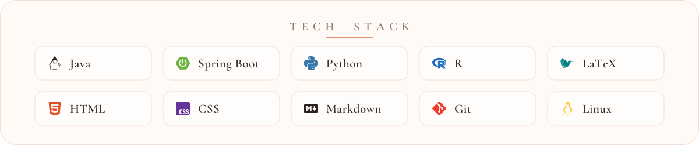

  <picture>
    <source media="(prefers-color-scheme: dark)" srcset="./assets/hero-dark.svg" />
    <source media="(prefers-color-scheme: light)" srcset="./assets/hero-light.svg" />
    
  </picture>

  <a href="https://space.bilibili.com/36023418"><picture><source media="(prefers-color-scheme: dark)" srcset="./assets/btn-bilibili-dark.svg" /></picture></a>&nbsp;&nbsp;
  <a href="https://www.youtube.com/@Asami_Akito"><picture><source media="(prefers-color-scheme: dark)" srcset="./assets/btn-youtube-dark.svg" /></picture></a>&nbsp;&nbsp;
  <a href="./assets/wechat-qr.png"><picture><source media="(prefers-color-scheme: dark)" srcset="./assets/btn-wechat-dark.svg" /></picture></a>

 

  <picture>
    <source media="(prefers-color-scheme: dark)" srcset="./assets/stack-dark.svg" />
    <source media="(prefers-color-scheme: light)" srcset="./assets/stack-light.svg" />
    
  </picture>

 

  <picture>
    <source media="(prefers-color-scheme: dark)" srcset="https://raw.githubusercontent.com/AsamiAkito/AsamiAkito/output/snake-dark.svg" />
    <source media="(prefers-color-scheme: light)" srcset="https://raw.githubusercontent.com/AsamiAkito/AsamiAkito/output/snake-light.svg" />
    
  </picture>

  <picture>
    <source media="(prefers-color-scheme: dark)" srcset="./assets/footer-dark.svg" />
    <source media="(prefers-color-scheme: light)" srcset="./assets/footer-light.svg" />
    
  </picture>

